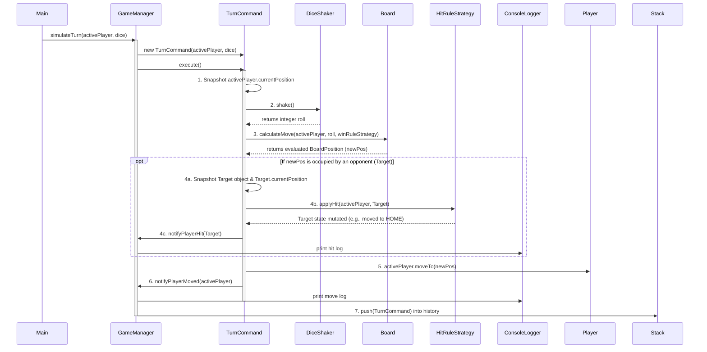
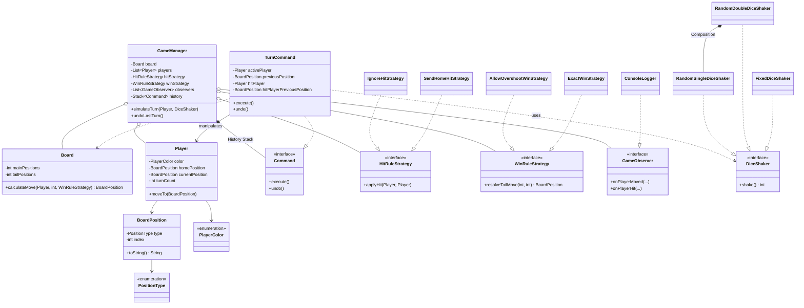

# Simple Frustration 文档

## 第 1 部分：核心类、架构与设计优势

为了实现高内聚、低耦合的架构，系统的 20 个组件被划分为六个功能模块。每个类、接口和枚举的设计都遵循了 **SOLID 原则**，并避免了基本类型偏执（primitive obsession）。

### 1.1 基础与数据实体

-   **`PlayerColor` & `PositionType` (枚举)**
-   **职责：** 定义有效的颜色集合（`RED`, `BLUE`, `GREEN`, `YELLOW`）和棋盘区域（`HOME`, `MAIN`, `TAIL`, `END`）。
-   **设计优势：** 提供强大的**类型安全（Type Safety）**。使用枚举代替随意的字符串或整数标识符，可以防止由于拼写错误和无效状态导致的运行时错误。

-   **`BoardPosition` (值对象)**
-   **职责：** 棋盘上的特定位置，包含一个 `PositionType` 和一个索引。它还具有用于日志记录的字符串格式化功能。
-   **设计优势：** 解决**基本类型偏执**问题。为了使该类不可变，将其字段声明为 `final` 并且不提供 setter 方法；否则，位置数据可能会在复杂的游戏操作或状态保存期间被意外更改。重写 `toString()` 方法符合**单一职责原则 (SRP)**，将 UI 格式化逻辑排除在游戏引擎之外。

-   **`Player` (实体)**
-   **职责：** 存储游戏玩家的属性，如颜色、老家（home base）、当前位置和回合数。
-   **设计优势：** 实现**封装**。内部状态为 `private`，只能通过显式的命令方法（`moveTo`，`incrementTurn`）进行更改。因此，外部类无法设置无效的回合数或非法的坐标。

### 1.2 核心游戏引擎与数学逻辑

-   **`Board` (数学模型)**
-   **职责：** 根据玩家的当前位置、掷骰子点数以及棋盘尺寸（主干长度和尾巴长度）计算玩家的精确目的地。
-   **设计优势：** 将数学逻辑与游戏控制器隔离，以遵循 **SRP（单一职责原则）**。通过在构造函数中提供不同的参数（例如 36 和 6），可以直接支持大棋盘（Large Board）变体，而无需修改代码。

-   **`GameManager` (核心控制器)**
-   **职责：** 管理游戏生命周期。它保存对棋盘、玩家、注入的策略和命令历史的引用，并分配回合，而不执行底层算术运算。
-   **设计优势：** 作为一个高层协调者，利用**依赖注入 (DI)**。将规则委托给策略，将打印委托给观察者，并使用 `Board` 进行数学计算，从而实现极度松散的耦合。

### 1.3 动力源

-   **`DiceShaker` (接口)**
-   **职责：** 定义生成移动步数的契约（`shake()`）。
-   **设计优势：** 实现**依赖倒置原则 (DIP)**。`GameManager` 依赖此接口，在切换逻辑时无需了解具体的骰子实现。

-   **`RandomSingleDiceShaker` & `RandomDoubleDiceShaker` (实现类)**
-   **职责：** 生成随机值（1-6 或 2-12）。
-   **设计优势：** 双骰子（Double Dice）摇骰器使用**合成复用原则 (Composite Reuse Principle)** 来组合两个单骰子实例，而不是使用继承，从而降低了耦合度。

-   **`FixedDiceShaker` (实现类)**
-   **职责：** 从预定义的数组中按顺序返回数字。
-   **设计优势：** 对于自动化测试和演示必不可少。可以在没有随机性的情况下对复杂的边界情况（Exact Win 后退）进行确定性测试。

### 1.4 规则引擎

-   **`HitRuleStrategy` (接口), `IgnoreHitStrategy`, & `SendHomeHitStrategy`**
-   **职责：** 决定玩家落在一个已被占据的方块上时的行为。`IgnoreHitStrategy` 不执行任何操作（基础游戏），而 `SendHomeHitStrategy` 会将被踩玩家（victim）传送回老家 HOME（变体规则）。
-   **设计优势：** 遵循**开闭原则 (OCP)**。不要在 `GameManager` 中为碰撞逻辑使用脆弱的 `if-else` 语句。可以作为新类添加新规则，而无需更改现有代码。

-   **`WinRuleStrategy` (接口), `AllowOvershootWinStrategy`, & `ExactWinStrategy`**
-   **职责：** 计算进入尾巴 (TAIL) 时的最终位置。`AllowOvershoot` 允许越过终点 (END)，而 `ExactWin` 会触发复杂的倒退计算。
-   **设计优势：** 与碰撞规则（Hit Rules）类似，将胜利算法提取为可替换的策略，使核心引擎免受变体修改的影响。

### 1.5 撤销管理

-   **`Command` (接口) & `TurnCommand` (实现类)**
-   **职责：** 将单个玩家的回合（掷骰子、移动、碰撞）封装到具有 `execute()` 和 `undo()` 方法的独立对象中。
-   **设计优势：** 解决复杂的“撤销碰撞 (Undo a Hit)”需求。该命令会记录“案发现场”，即移动玩家的前一个状态以及发生碰撞时被踩玩家的精确位置。它可以完美恢复之前的状态（在正确的位置复活被踩玩家），而无需在 `GameManager` 中使用回滚逻辑。

### 1.6 控制台日志

-   **`GameObserver` (接口) & `ConsoleLogger` (实现类)**
-   **职责：** 监听游戏事件（移动、碰撞、超出、撤销）并将其格式化为控制台输出。
-   **设计优势：** 将业务逻辑与 UI 展示解耦。`GameManager`（被观察者）仅发出事件。`ConsoleLogger` 是唯一允许使用 `System.out.println()` 的类；否则，系统将不适合未来的升级。

---

## 第 2 部分：核心算法与功能实现

本节介绍了用于实现主要游戏物理、变体和高级功能的数学和逻辑算法。

### 2.1 环形棋盘与尾巴路由算法 (`Board.calculateMove`)
-   **实现的功能：** 基础游戏移动逻辑和大棋盘变体。
-   **运作方式：** 不是使用固定位置索引（例如，`if position > 18`），而是为每个玩家计算一个数学上的“拐点（Diversion Point）”，该点恰好在他们 `HOME` 索引的前一个位置。
    1. 准确计算从玩家当前位置到拐点的距离。
    2. 如果 `roll <= distance`，玩家停留在主棋盘上。算法采用类似取模的绕环机制（`nextIndex -= mainPositions`）来实现环形移动。
    3. 如果掷骰子点数过大，那么就会进入尾巴。算法确定剩余的步数（`stepsIntoTail`），并调用注入的 `WinRuleStrategy` 来得出最终位置。
-   **为什么使用此算法：** 为了防止硬编码的限制。棋盘可以被看作是一个数学几何问题，从而在无需修改任何逻辑的情况下自动处理不同尺寸的棋盘（例如，36 个主干 + 6 个尾巴）；只需要更改构造函数参数即可。

### 2.2 精确胜利与超出倒退算法 (`ExactWinStrategy`)
-   **实现的功能：** 精确到达 END 位置胜利（Exact END Position Win）变体规则。
-   **运作方式：** 当玩家到达尾巴时，确定 `stepsIntoTail` 是否等于 `tailPositions`。如果长于尾巴长度，则将执行分两步的倒退计算：
    1. 因此，它尚未到达终点，计算出超出（overshoot）的数量。
    2. 计算 `backoffPos = tailPositions - overshoot`。
    3. 如果 `backoffPos > 0`，玩家向后弹回，但仍留在尾巴 (TAIL) 内。
    4. 如果 `backoffPos <= 0`，玩家已经移出了尾巴。从拐点中减去这个负值，将它们反向放置在主棋盘上，并在必要时进行环形连接。
-   **为什么使用此算法：** 在两个坐标系（尾巴和主干）中向后弹回的边界物理计算非常复杂。将此算法封装在一个策略（Strategy）中，以保持 `Board` 类的整洁，并符合**单一职责原则 (SRP)**。

### 2.3 状态捕获撤销算法 (`TurnCommand`)
-   **实现的功能：** 撤销碰撞（Undo a Hit）高级功能。
-   **运作方式：** 它通过对旧状态执行逆向添加来工作。撤销碰撞 (Hit) 需要恢复受损的状态。
    1. **执行 (捕获)：** 在移动当前玩家之前，`TurnCommand` 捕获其 `previousPosition`。它会自动寻找目的地。如果目的地格子上有对手，命令会在执行碰撞策略之前，保存对这个 `hitPlayer`（被踩玩家）的引用，并缓存其 `hitPlayerPreviousPosition`。
    2. **撤销 (恢复)：** 命令将当前玩家移回先前的位置。然后它检查缓存。如果记录了被踩玩家（victim），它显式调用 `hitPlayer.moveTo(hitPlayerPreviousPosition)` 将被踩玩家传送回“案发现场”。
-   **为什么使用此算法：** 这种命令模式的实现提供了 $O(1)$ 的状态恢复。它不是在每个回合保存所有玩家的完整世界状态，而是仅仅保存命令的增量（即在特定回合中发生更改的对象和位置），从而实现高性能。

---

## 第 3 部分：逻辑执行顺序

本节将详细介绍单个玩家回合的逻辑生命周期。它展示了掷骰子、碰撞处理和历史存档的精确数据流、状态管理和组件交互序列。

### 3.1 执行流程 (时序图)

### 3.2 回合的完整生命周期

为了保证数据一致性并支持撤销（Undo）等高级功能，回合的执行采用了严格的 7 阶段生命周期。

1. **回合封装 (命令初始化)：** 当调用 `GameManager.simulateTurn()` 时，引擎不会立即更改玩家位置。相反，它创建一个 `TurnCommand` 并注入当前活动玩家和动力源（`DiceShaker`）。因此，执行回合的责任将由命令（Command）模式承担。
2. **状态快照与动力生成：** 在发生任何状态改变之前，`TurnCommand` 创建活动玩家 `currentPosition` 的深拷贝。然后它调用抽象的 `DiceShaker` 的 `shake()` 方法来获取移动步数，主逻辑完全独立于使用的是 1 个还是 2 个骰子。
3. **数学计算 (棋盘路由)：** 命令将活动玩家和掷骰子点数传递给纯数学引擎：`Board.calculateMove()`。`Board` 确定到拐点的距离。如果点数超过此限制，则 `Board` 将需要询问动态添加的 `WinRuleStrategy` 来进行最终的获胜或超出（overshoot）的位置计算。最终返回一个不可变的 `BoardPosition`。
4. **主动碰撞拦截：** 在移动活动玩家之前，`TurnCommand` 会扫描计算出的目的地格子。如果有对手，命令会立即获取被踩玩家（victim）的对象引用及其原始位置。只有在保存了此快照之后，才会调用注入的 `HitRuleStrategy` 来执行变体逻辑，例如将被踩玩家送回 HOME。
5. **执行 (状态改变)：** 在解决所有碰撞并安全缓存先前状态后，命令最终通过调用 `activePlayer.moveTo(newPos)` 并更新他们的回合数来改变活动玩家的状态。
6. **事件广播 (观察者触发)：** `TurnCommand` 调用 `GameManager`（被观察者）的通知方法。`GameManager` 盲目地将状态更改广播给 `ConsoleLogger`（观察者），`ConsoleLogger` 在不更改领域逻辑的情况下格式化并打印作业要求中确切的规范输出。
7. **历史归档：** 完全执行的 `TurnCommand`（现在包含“案发现场”的完整信息：活动玩家和任何被踩玩家的先前位置）被推入 `GameManager` 的历史栈（Stack）。如果随后调用 `undoLastTurn()`，则弹出此命令，并利用其确切的快照数据在 $O(1)$ 时间内完美逆转时间线。

---

## 第 4 部分：高级设计模式与 UML 类图

最后，通过完整的 UML 类图展示了系统的整体结构，并分析了 GoF 设计模式是如何满足 SOLID 原则的。

### 4.1 完整系统架构 (UML 类图)

### 4.2 宏观设计模式讨论

本项目严格应用面向对象设计（OOD）模式并遵循 SOLID 原则，以支持可维护性和可扩展性。

1. **策略模式 -> 开闭原则 (OCP)：** 将碰撞规则（`HitRuleStrategy`）和尾巴移动规则（`WinRuleStrategy`）抽象为可互换的接口，核心 `GameManager` 引擎将对修改保持封闭，但对扩展完全开放。当需要新的游戏变体时，可以实现一个新的策略类并在运行时注入，而不会改变现有系统的核心逻辑。
2. **观察者模式 -> 单一职责原则 (SRP) & 松耦合：** 作业要求为回合事件的控制台输出提供许多不同的格式。直接将 `System.out.println` 嵌入 `GameManager` 或 `TurnCommand` 会导致严重的控制台 UI 逻辑耦合。观察者模式将用于在 `ConsoleLogger` 中处理 I/O 字符串格式化。`GameManager` 只是一个可观察的广播器（Observable broadcaster），因此它是完全解耦的，适合引擎未来的 GUI 集成。
3. **命令模式 -> 封装 & 健壮的状态管理：** 由于状态破坏，为复杂的碰撞实现撤销功能本质上是很困难的。命令模式（`TurnCommand`）可用于将功能操作封装在持有状态的对象中。命令在本地缓存了“案发现场”的确切增量信息（被踩玩家的引用及其在碰撞前的精确位置），并能实现 $O(1)$ 的完美状态恢复，而无需在 `GameManager` 中使用庞大的全局备忘录（mementos）。
